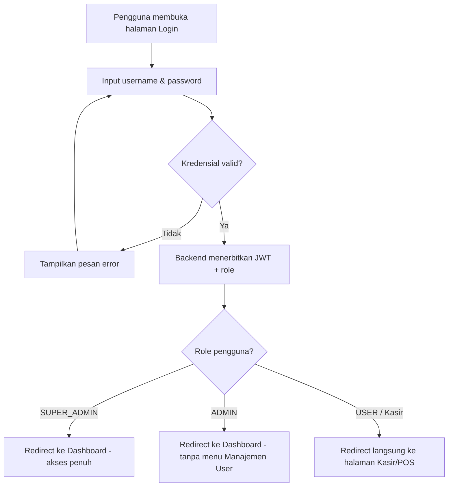
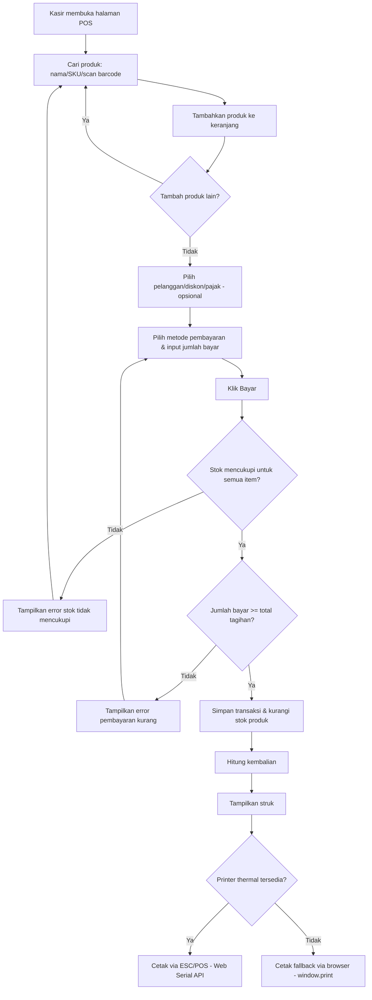
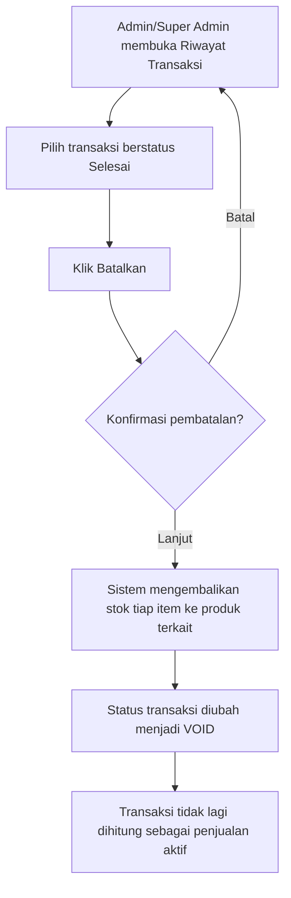
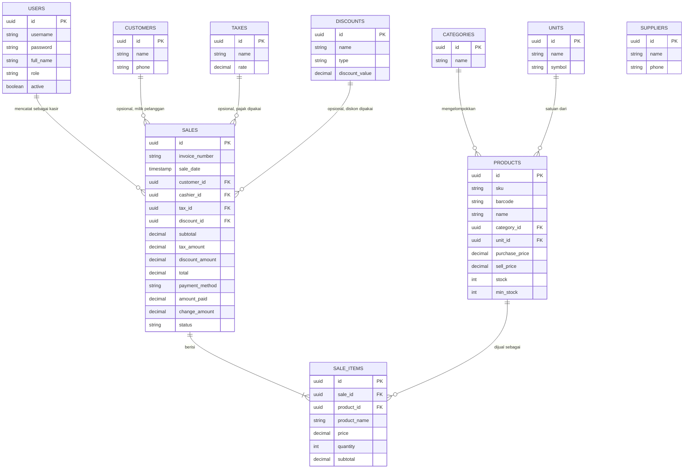
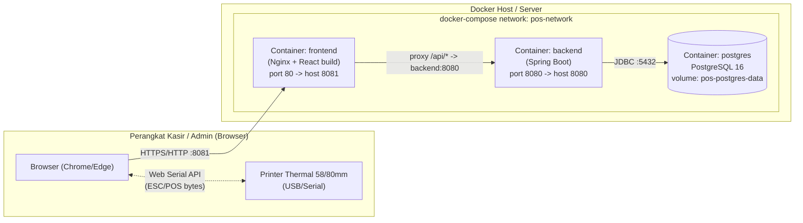

# Business Requirement Document (BRD)
## Aplikasi Point of Sale (POS App)

| | |
|---|---|
| **Versi Dokumen** | 1.0 |
| **Status** | Final draft untuk implementasi |
| **Jenis Sistem** | Aplikasi Point of Sale berbasis web, single store |

---

## 1. Latar Belakang

Toko yang masih mencatat transaksi penjualan secara manual (atau dengan alat bantu terpisah-pisah seperti spreadsheet) menghadapi beberapa masalah:

- Perhitungan total belanja, diskon, dan pajak rawan salah hitung.
- Tidak ada pencatatan stok yang otomatis berkurang saat terjadi penjualan, sehingga stok fisik dan catatan sering tidak sinkron.
- Tidak ada pemisahan hak akses yang jelas antara pemilik/pengelola sistem, admin toko, dan kasir harian.
- Laporan penjualan sulit direkap untuk kebutuhan evaluasi bisnis maupun pelaporan pajak.
- Struk transaksi harus ditulis manual atau dicetak dari alat yang tidak terhubung ke sistem pencatatan.

Dibutuhkan sebuah **aplikasi Point of Sale (POS)** yang terintegrasi: mulai dari pengelolaan data master, transaksi kasir, hingga pelaporan - dengan kontrol akses berbasis role agar setiap pihak hanya bisa melakukan aksi sesuai kewenangannya.

## 2. Tujuan

1. Menyediakan satu sistem POS yang menangani transaksi penjualan dari pencarian produk sampai cetak struk.
2. Memastikan stok produk ter-update otomatis dan akurat setiap kali terjadi penjualan atau pembatalan transaksi.
3. Menyediakan 3 tingkat hak akses (Super Admin, Admin, Kasir/User) sehingga setiap pengguna hanya melihat dan mengelola apa yang relevan dengan perannya.
4. Menyediakan laporan penjualan dan stok yang dapat diekspor ke CSV untuk kebutuhan analisis/pembukuan.
5. Menyediakan struk transaksi yang dapat dicetak baik melalui printer thermal maupun melalui browser sebagai cadangan.

## 3. Ruang Lingkup

### 3.1 Termasuk dalam ruang lingkup (in-scope)

- Autentikasi berbasis JWT dengan 3 role: **SUPER_ADMIN**, **ADMIN**, **USER** (kasir).
- Redirect otomatis setelah login: Super Admin & Admin ke Dashboard, Kasir langsung ke halaman transaksi (POS).
- Manajemen master data: Produk, Kategori, Satuan, Pelanggan, Supplier, Pajak, Diskon, dan Pengguna/Role.
- Modul transaksi kasir (POS): pencarian produk, keranjang, pemilihan pelanggan/diskon/pajak (opsional), input pembayaran, perhitungan kembalian, pengurangan stok otomatis.
- Riwayat transaksi dan pembatalan transaksi (void) yang mengembalikan stok.
- Cetak struk: byte ESC/POS untuk printer thermal (via Web Serial API di browser) dan tampilan HTML 80mm sebagai fallback cetak biasa.
- Laporan (ekspor CSV): ringkasan penjualan, rincian item terjual, dan stok produk.
- Dokumentasi Swagger/OpenAPI untuk seluruh REST API.
- Containerization (Dockerfile backend & frontend, docker-compose untuk orkestrasi bersama PostgreSQL).

### 3.2 Tidak termasuk ruang lingkup (out-of-scope) untuk versi ini

- Multi-cabang/multi-toko (sistem dirancang untuk **satu toko/outlet**).
- Integrasi payment gateway online (QRIS/kartu dicatat sebagai metode pembayaran, bukan diproses lewat gateway pihak ketiga).
- Manajemen purchase order/pembelian ke supplier (data supplier disimpan sebagai master data referensi, alur pembelian barang belum otomatis memotong/menambah stok).
- Aplikasi mobile native (cukup web responsif).
- Notifikasi push/email otomatis (mis. notifikasi stok menipis hanya tampil di dashboard, belum dikirim via email/WA).

## 4. Stakeholder

| Stakeholder | Kepentingan |
|---|---|
| Pemilik Toko / Super Admin | Kontrol penuh sistem: kelola akun pengguna, lihat seluruh laporan, pengaturan pajak/diskon |
| Admin Toko | Mengelola data produk, pelanggan, supplier, dan memantau laporan penjualan harian |
| Kasir (User) | Memproses transaksi penjualan sehari-hari dan mencetak struk untuk pelanggan |
| Pelanggan Toko | Penerima struk transaksi, tidak berinteraksi langsung dengan sistem |
| Tim Pengembang/IT | Membangun, memelihara, dan men-deploy sistem |

## 5. Kebutuhan Fungsional

### 5.1 Matriks Hak Akses per Role

| Fitur | Super Admin | Admin | Kasir (User) |
|---|:---:|:---:|:---:|
| Login & redirect otomatis ke halaman sesuai role | ✅ | ✅ | ✅ |
| Kelola akun pengguna & role | ✅ | ❌ | ❌ |
| Kelola master data (produk, kategori, satuan, pelanggan, supplier, pajak, diskon) | ✅ | ✅ | ❌ (hanya baca, dipakai saat transaksi) |
| Transaksi kasir (buat penjualan baru) | ✅ | ✅ | ✅ |
| Melihat riwayat transaksi | ✅ (semua) | ✅ (semua) | ✅ (miliknya sendiri) |
| Membatalkan transaksi (void) & kembalikan stok | ✅ | ✅ | ❌ |
| Cetak struk (thermal & fallback browser) | ✅ | ✅ | ✅ |
| Ekspor laporan CSV (penjualan & stok) | ✅ | ✅ | ❌ |

### 5.2 Daftar Kebutuhan Fungsional

| ID | Kebutuhan | Prioritas |
|---|---|---|
| FR-01 | Sistem menyediakan login dengan username & password, mengembalikan token JWT dan role pengguna | Wajib |
| FR-02 | Sistem mengarahkan pengguna ke halaman berbeda setelah login sesuai role (Kasir → halaman POS, Admin/Super Admin → Dashboard) | Wajib |
| FR-03 | Sistem menyediakan CRUD untuk master data Produk (SKU, barcode, kategori, satuan, harga beli/jual, stok, stok minimum) | Wajib |
| FR-04 | Sistem menyediakan CRUD untuk master data Kategori dan Satuan | Wajib |
| FR-05 | Sistem menyediakan CRUD untuk master data Pelanggan dan Supplier | Wajib |
| FR-06 | Sistem menyediakan CRUD untuk master data Pajak (persentase) dan Diskon (persentase/nominal) | Wajib |
| FR-07 | Sistem menyediakan CRUD akun pengguna beserta penentuan role, khusus Super Admin | Wajib |
| FR-08 | Sistem menyediakan halaman kasir untuk mencari produk, menambah ke keranjang, memilih pelanggan/diskon/pajak, dan memproses pembayaran | Wajib |
| FR-09 | Sistem menghitung otomatis subtotal, potongan diskon, pajak, total tagihan, dan kembalian | Wajib |
| FR-10 | Sistem mengurangi stok produk secara otomatis dan atomik saat transaksi berhasil, serta menolak transaksi bila stok tidak mencukupi | Wajib |
| FR-11 | Sistem mencatat nomor invoice unik untuk setiap transaksi | Wajib |
| FR-12 | Sistem menyediakan fitur pembatalan transaksi (void) yang mengembalikan stok produk terkait | Diinginkan |
| FR-13 | Sistem menyediakan cetak struk dalam format ESC/POS untuk printer thermal | Wajib |
| FR-14 | Sistem menyediakan cetak struk fallback berbasis HTML/browser bila printer thermal tidak tersedia | Wajib |
| FR-15 | Sistem menyediakan ekspor laporan penjualan (ringkasan & rincian item) dan laporan stok dalam format CSV | Wajib |
| FR-16 | Sistem menampilkan dashboard ringkasan (jumlah transaksi hari ini, total penjualan, grafik 7 hari terakhir, peringatan stok menipis) untuk Admin/Super Admin | Diinginkan |
| FR-17 | Seluruh API didokumentasikan melalui Swagger/OpenAPI | Wajib |

## 6. Kebutuhan Non-Fungsional

| ID | Kebutuhan |
|---|---|
| NFR-01 | **Keamanan**: autentikasi stateless berbasis JWT, password disimpan ter-hash (BCrypt), otorisasi per endpoint ditegakkan berdasarkan role (`@PreAuthorize`). |
| NFR-02 | **Responsif**: antarmuka dapat digunakan dengan baik di desktop, tablet, maupun mobile (breakpoint Tailwind CSS), termasuk saat digunakan di perangkat kasir berlayar kecil. |
| NFR-03 | **Konsistensi data transaksi**: pengurangan stok dan pencatatan transaksi berada dalam satu transaksi database (`@Transactional`) dengan pessimistic locking pada baris produk untuk mencegah stok minus akibat transaksi bersamaan. |
| NFR-04 | **Auditability**: setiap record memiliki jejak audit (dibuat/diubah oleh siapa dan kapan) melalui field bawaan (`createdAt`, `updatedAt`, `createdBy`, `updatedBy`). |
| NFR-05 | **Portabilitas**: seluruh komponen (backend, frontend, database) dapat dijalankan via Docker/`docker-compose` tanpa instalasi manual dependency di host. |
| NFR-06 | **Skalabilitas kode**: backend memakai arsitektur berlapis (controller-service-repository) dengan DTO terpisah dari entity agar mudah dikembangkan/diuji. |
| NFR-07 | **Testability**: modul-modul inti (autentikasi, transaksi, role-based access) memiliki automated test (JUnit/Mockito) yang dijalankan sebelum rilis. |

## 7. Alur Proses (Flowchart)

### 7.1 Alur Login & Redirect Berdasarkan Role

### 7.2 Alur Transaksi Penjualan (Kasir)

### 7.3 Alur Pembatalan Transaksi (Void)

## 8. Entity Relationship Diagram (ERD)

> Catatan: tabel `SUPPLIERS` disimpan sebagai master data referensi (untuk pencatatan sumber barang) dan belum memiliki relasi transaksi otomatis pada versi ini (lihat 3.2 Out-of-Scope).

## 9. Topologi Deployment

Poin penting topologi:

- **Frontend** (Nginx + hasil build React) dan **backend** (Spring Boot) dan **database** (PostgreSQL) masing-masing berjalan sebagai container terpisah, terhubung dalam satu Docker network (`pos-network`) yang dibuat otomatis oleh `docker-compose`.
- Browser klien hanya berbicara ke container frontend; permintaan API diteruskan (reverse proxy) oleh Nginx ke container backend, sehingga backend tidak perlu diekspos langsung ke publik.
- Printer thermal terhubung ke **perangkat klien** (bukan ke server), dan dikendalikan langsung dari browser melalui Web Serial API - tidak memerlukan service tambahan di server.
- Data PostgreSQL disimpan pada Docker volume (`pos-postgres-data`) agar tetap ada walau container database di-restart/rebuild.

## 10. Asumsi & Batasan

- Sistem digunakan untuk **satu toko/outlet** (tidak ada konsep cabang/multi-tenant).
- Satu perangkat/browser hanya login dengan satu akun pada satu waktu (tidak ada dukungan multi-session eksplisit di luar yang disediakan JWT).
- Cetak struk thermal mengandalkan **Web Serial API**, yang saat ini hanya didukung oleh browser berbasis Chromium (Chrome, Edge) versi terbaru; browser lain otomatis memakai fallback cetak HTML.
- Metode pembayaran non-tunai (Debit, Kredit, QRIS, Transfer) hanya dicatat sebagai label pada transaksi - proses otorisasi pembayaran sesungguhnya dilakukan di luar sistem (mesin EDC/aplikasi pembayaran terpisah).
- Harga & stok bersifat snapshot pada saat transaksi (harga yang tercatat di `sale_items` tidak berubah walau harga produk diubah kemudian).

## 11. Risiko

| Risiko | Dampak | Mitigasi |
|---|---|---|
| Password default (`Password123!`) tidak diganti setelah instalasi | Akses tidak sah ke sistem | Wajib ganti password saat instalasi pertama (didokumentasikan di README & panduan pengguna) |
| `JWT_SECRET` default dipakai di lingkungan produksi | Token dapat dipalsukan | Wajib override `JWT_SECRET` via environment variable saat deploy produksi |
| Browser klien bukan Chrome/Edge sehingga Web Serial tidak tersedia | Tidak bisa cetak langsung ke printer thermal | Tersedia fallback cetak HTML/browser di setiap struk |
| Dua kasir memproses produk yang sama secara bersamaan (race condition stok) | Stok bisa salah hitung | Pessimistic locking pada baris produk saat transaksi (lihat NFR-03) |
| Transaksi dibatalkan (void) berkali-kali atau pada data yang salah | Rekonsiliasi stok tidak akurat | Void hanya bisa dilakukan sekali per transaksi dan dibatasi untuk role Admin/Super Admin |
