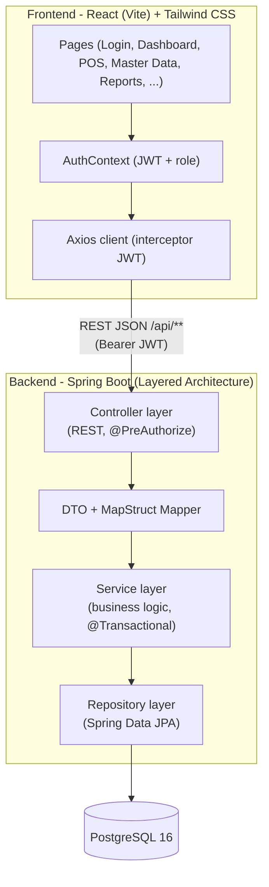
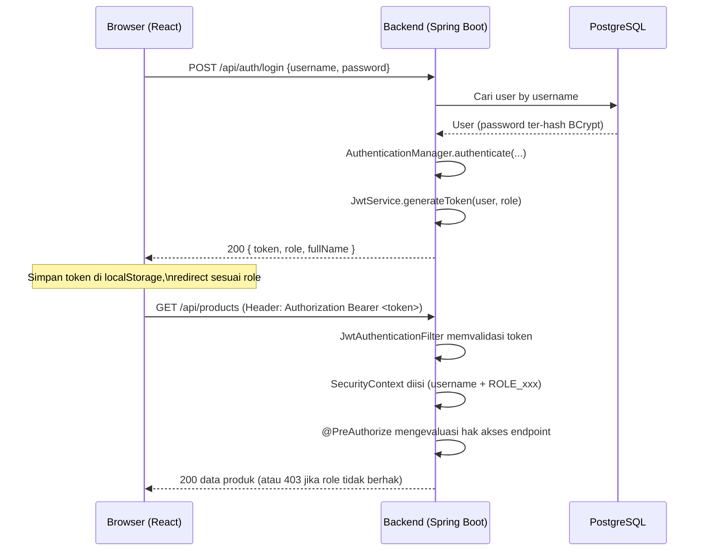

# Dokumentasi Teknis - POS App

Dokumen ini menjelaskan arsitektur, tech stack, struktur proyek, cara menjalankan, dan detail teknis lain dari aplikasi Point of Sale. Untuk kebutuhan bisnis lihat [`BRD.md`](./BRD.md); untuk panduan pemakaian non-teknis lihat [`USER_GUIDE.md`](./USER_GUIDE.md).

## 1. Ringkasan Arsitektur



Backend mengikuti **layered architecture** klasik Spring Boot:

```
Controller  → menerima HTTP request, validasi input (@Valid), menegakkan otorisasi (@PreAuthorize)
   ↓
DTO/Mapper  → mengonversi request/response DTO ⇄ entity (MapStruct), agar entity JPA tidak pernah bocor ke API
   ↓
Service     → interface + implementasi berisi business logic (perhitungan transaksi, validasi stok, dst), @Transactional
   ↓
Repository  → interface Spring Data JPA (query method + @Query kustom)
   ↓
Entity      → JPA entity, seluruhnya extends AbstractBaseEntity untuk field umum (lihat 2.1)
```

## 2. Konvensi & Pola Kode Penting

### 2.1 `BaseEntity` (abstract class)

Semua entity (`Product`, `Category`, `Customer`, `Supplier`, `Tax`, `Discount`, `User`, `Sale`, `SaleItem`, dst.) meng-extend `com.pos.common.entity.BaseEntity`, yang menyediakan:

- `id` (UUID, auto-generate via `@UuidGenerator`)
- `createdAt` / `updatedAt` (audit timestamp otomatis via Spring Data JPA Auditing)
- `createdBy` / `updatedBy` (username pengguna yang login, diisi lewat `AuditorAware` bean di `JpaAuditingConfig`)
- `version` (optimistic locking)

Ini menghindari duplikasi field yang sama di setiap model, sekaligus menstandardisasi audit trail (lihat NFR-04 di BRD).

### 2.2 DTO & Mapper

Setiap modul memisahkan `dto/request` dan `dto/response` dari entity JPA-nya, dikonversi lewat MapStruct (`@Mapper(componentModel = "spring")`). Controller **tidak pernah** menerima/mengembalikan entity JPA secara langsung.

### 2.3 Response Envelope

Semua endpoint REST mengembalikan bentuk seragam `ApiResponse<T>`:

```json
{
  "success": true,
  "message": "OK",
  "data": { "...": "..." },
  "timestamp": "2026-01-01T00:00:00Z"
}
```

Data ter-paginasi dibungkus lagi sebagai `PageResponse<T>` di dalam field `data` (`content`, `pageNumber`, `pageSize`, `totalElements`, `totalPages`, `last`).

### 2.4 Error Handling

`GlobalExceptionHandler` (`@RestControllerAdvice`) menangkap seluruh exception domain (`ResourceNotFoundException` → 404, `DuplicateResourceException`/`InsufficientStockException` → 409, `BadRequestException`/validasi → 400, `AccessDeniedException` → 403, `BadCredentialsException` → 401) dan mengembalikannya sebagai `ApiResponse.error(...)`.

### 2.5 Keamanan (Spring Security + JWT)



- Token JWT (HS256) berisi `subject` = username dan claim `role`.
- Password disimpan ter-hash dengan **BCrypt** (`PasswordEncoder`).
- Endpoint publik (tanpa token): `/api/auth/**`, `/swagger-ui/**`, `/v3/api-docs/**`, `/actuator/health`.
- Selebihnya wajib token valid; request tanpa/dengan token invalid → **401**. Token valid tapi role tidak berhak (`@PreAuthorize`) → **403**.
- Otorisasi method-level dengan `@PreAuthorize("hasAnyRole('SUPER_ADMIN','ADMIN')")` dsb, sesuai matriks hak akses di BRD §5.1.

### 2.6 Perhitungan Transaksi (SaleServiceImpl)

1. Untuk setiap item di keranjang: kunci baris produk (`SELECT ... FOR UPDATE` via `@Lock(PESSIMISTIC_WRITE)`), validasi stok cukup, kurangi stok, catat harga jual saat itu (snapshot) ke `sale_items`.
2. `subtotal` = Σ (harga × qty).
3. `discountAmount` = persentase × subtotal, atau nominal tetap (dibatasi maksimal sebesar subtotal).
4. `taxAmount` = tarif pajak × (subtotal − discountAmount).
5. `total` = (subtotal − discountAmount) + taxAmount.
6. Validasi `amountPaid >= total`, lalu `changeAmount` = amountPaid − total.
7. Nomor invoice dibuat dari sequence database (`sale_invoice_seq`) diformat `INV-yyyyMMdd-000001`.
8. Seluruh proses berada dalam satu `@Transactional` - jika gagal di tengah jalan (mis. stok kurang), seluruh perubahan (termasuk pengurangan stok item sebelumnya) di-rollback.

### 2.7 Struk / Bill (ESC/POS)

- `ReceiptService` membangun dua representasi struk dari data transaksi (`SaleResponse`):
  - `GET /api/sales/{id}/receipt` → JSON terstruktur (`ReceiptView`), dipakai frontend untuk merender tampilan 80mm dan fallback `window.print()`.
  - `GET /api/sales/{id}/receipt/escpos` → `application/octet-stream`, berisi byte perintah ESC/POS mentah (dibangun manual lewat `EscPosBuilder`, tanpa dependency tambahan).
- Frontend mengirim byte ESC/POS tersebut ke printer thermal via **Web Serial API** (`navigator.serial`, Chrome/Edge) menggunakan hook `usePrinter()`.

## 3. Tech Stack

| Layer | Teknologi |
|---|---|
| Backend framework | Spring Boot 3.3 (Java 17) |
| Keamanan | Spring Security 6 + JWT (jjwt 0.12) |
| Persistence | Spring Data JPA (Hibernate 6) + PostgreSQL 16 |
| Migrasi database | Flyway |
| Mapping DTO ⇄ Entity | MapStruct |
| Boilerplate | Lombok |
| Dokumentasi API | springdoc-openapi (Swagger UI) |
| Export CSV | OpenCSV |
| Testing | JUnit 5, Mockito, Spring Security Test, H2 (in-memory test DB) |
| Build tool backend | Maven |
| Frontend framework | React 19 (Vite) |
| Routing | React Router v6 |
| Data fetching/cache | TanStack React Query |
| HTTP client | Axios |
| Styling | Tailwind CSS v4 |
| Grafik dashboard | Recharts |
| Build tool frontend | Vite |
| Kontainerisasi | Docker (multi-stage build), docker-compose |
| Web server statis | Nginx (serve build React + reverse proxy `/api`) |

## 4. Struktur Folder

```
pos-app-java/
├── backend/
│   ├── src/main/java/com/pos/
│   │   ├── PosApplication.java
│   │   ├── common/        # BaseEntity, ApiResponse, PageResponse, exceptions
│   │   ├── config/        # SecurityConfig, JpaAuditingConfig, OpenApiConfig
│   │   ├── security/      # Role, JwtService, JwtAuthenticationFilter, SecurityUtils
│   │   ├── auth/          # Login (AuthController/Service + dto)
│   │   ├── user/          # Manajemen user & role
│   │   ├── product/       # Produk, Kategori, Satuan
│   │   ├── partner/       # Pelanggan, Supplier
│   │   ├── pricing/       # Pajak, Diskon
│   │   ├── sales/         # Transaksi kasir (Sale, SaleItem)
│   │   ├── receipt/       # Struk (ESC/POS + printable view)
│   │   └── report/        # Ekspor CSV
│   ├── src/main/resources/
│   │   ├── application.yml
│   │   └── db/migration/  # V1__init.sql, V2__seed.sql (Flyway)
│   ├── src/test/java/...  # JUnit/Mockito unit test + integration test
│   ├── Dockerfile
│   └── pom.xml
├── frontend/
│   ├── src/
│   │   ├── api/            # axios client + modul endpoint per resource
│   │   ├── auth/            # AuthContext, ProtectedRoute
│   │   ├── layouts/          # AppLayout (sidebar per role) + navConfig
│   │   ├── components/       # CrudPage, Modal, ReceiptModal, dsb (reusable)
│   │   ├── hooks/             # useCrud (react-query wrapper generik)
│   │   └── pages/             # login, dashboard, pos, master-data, sales-history, reports
│   ├── Dockerfile
│   ├── nginx.conf
│   └── package.json
├── docs/
│   ├── BRD.md
│   ├── TECHNICAL.md (dokumen ini)
│   └── USER_GUIDE.md
├── docker-compose.yml
├── .env.example
└── README.md
```

## 5. Cara Menjalankan

### 5.1 Dengan Docker Compose (direkomendasikan)

```bash
cp .env.example .env
# (opsional) sunting .env, minimal ganti JWT_SECRET untuk produksi
docker compose up --build
```

- Frontend: http://localhost:8081
- Backend REST API: http://localhost:8082/api
- Swagger UI: http://localhost:8081/swagger-ui/index.html (diproksi lewat Nginx) atau langsung http://localhost:8082/swagger-ui/index.html
- PostgreSQL: `localhost:5434` (kredensial sesuai `.env`)

Saat backend pertama kali start, Flyway otomatis menjalankan migrasi (`V1__init.sql`, `V2__seed.sql`) yang membuat skema dan 3 akun contoh (lihat §6).

### 5.2 Menjalankan Manual (development)

**Backend** (butuh Java 17, Maven, PostgreSQL berjalan lokal):

```bash
cd backend
# set env var DB_URL/DB_USERNAME/DB_PASSWORD jika berbeda dari default di application.yml
mvn spring-boot:run
```

**Frontend** (butuh Node.js 20+):

```bash
cd frontend
npm install
npm run dev
# buka http://localhost:5173 - Vite dev server mem-proxy /api ke http://localhost:8080
```

### 5.3 Menjalankan Test

```bash
cd backend
mvn test
```

Cakupan test: unit test service (Auth, User, Product, Sale - termasuk perhitungan diskon/pajak/kembalian dan validasi stok), `@WebMvcTest` untuk endpoint login, `@DataJpaTest` untuk query stok menipis, dan integration test (`@SpringBootTest` + MockMvc) yang memverifikasi matriks hak akses per role end-to-end.

## 6. Akun Default (Seed Data)

| Username | Password | Role |
|---|---|---|
| `superadmin` | `Password123!` | SUPER_ADMIN |
| `admin` | `Password123!` | ADMIN |
| `kasir` | `Password123!` | USER (Kasir) |

**Wajib diganti** setelah instalasi pertama di lingkungan produksi (lewat halaman Manajemen User, login sebagai `superadmin`).

## 7. Konfigurasi Environment Variable

| Variabel | Default | Keterangan |
|---|---|---|
| `DB_URL` | `jdbc:postgresql://localhost:5432/pos_db` | Connection string PostgreSQL |
| `DB_USERNAME` / `DB_PASSWORD` | `pos_user` / `pos_password` | Kredensial database |
| `JWT_SECRET` | (nilai contoh, **wajib diganti**) | Kunci penandatanganan JWT, minimal 32 byte |
| `JWT_EXPIRATION_MS` | `86400000` (24 jam) | Masa berlaku token |
| `CORS_ALLOWED_ORIGINS` | `http://localhost:5173,http://localhost:8081` | Origin frontend yang diizinkan |
| `STORE_NAME` / `STORE_ADDRESS` / `STORE_PHONE` | contoh toko | Identitas yang tercetak di struk |
| `SERVER_PORT` | `8080` | Port HTTP backend |

## 8. Skema Database

Lihat ERD lengkap di [`BRD.md §8`](./BRD.md#8-entity-relationship-diagram-erd). Migrasi SQL sumber kebenaran ada di `backend/src/main/resources/db/migration/`.

## 9. Dokumentasi API (Swagger/OpenAPI)

Seluruh endpoint REST didokumentasikan otomatis oleh springdoc-openapi:

- UI interaktif: `/swagger-ui/index.html`
- Spesifikasi mentah (JSON): `/v3/api-docs`

Endpoint dikelompokkan per modul (tag): Autentikasi, Manajemen User, Master Data - Produk/Kategori/Satuan/Pelanggan/Supplier/Pajak/Diskon, Transaksi, Struk/Bill, Laporan. Untuk mencoba endpoint yang butuh login, klik tombol **Authorize** di Swagger UI dan masukkan `Bearer <token>` hasil `POST /api/auth/login`.

## 10. Deployment ke Server

1. Salin seluruh repo ke server (atau clone dari VCS).
2. Salin `.env.example` menjadi `.env`, isi `JWT_SECRET` dengan string acak yang kuat dan kredensial database produksi.
3. Jalankan `docker compose up --build -d`.
4. (Opsional) pasang reverse proxy TLS (mis. Nginx/Traefik/Caddy) di depan port frontend (8081) untuk HTTPS publik.
5. Backup rutin volume `pos-postgres-data` (atau lakukan `pg_dump` terjadwal).
6. Login sebagai `superadmin`, ganti password default, buat akun Admin/Kasir sesuai kebutuhan.

## 11. Keterbatasan Lingkungan Pengembangan Saat Ini

Backend telah dikompilasi, diuji (`mvn test`, 27 test - seluruhnya lulus), dan dikemas (`mvn package`) dalam sesi pengembangan ini. Frontend telah di-build (`npm run build`) dan dicek lint (`npm run lint`) tanpa error. **Build image Docker & `docker-compose up` end-to-end belum sempat diverifikasi otomatis** karena Docker Desktop/WSL integration tidak aktif pada environment pengembangan ini - disarankan menjalankan `docker compose up --build` secara manual setelah clone untuk verifikasi akhir sebelum deploy produksi.
